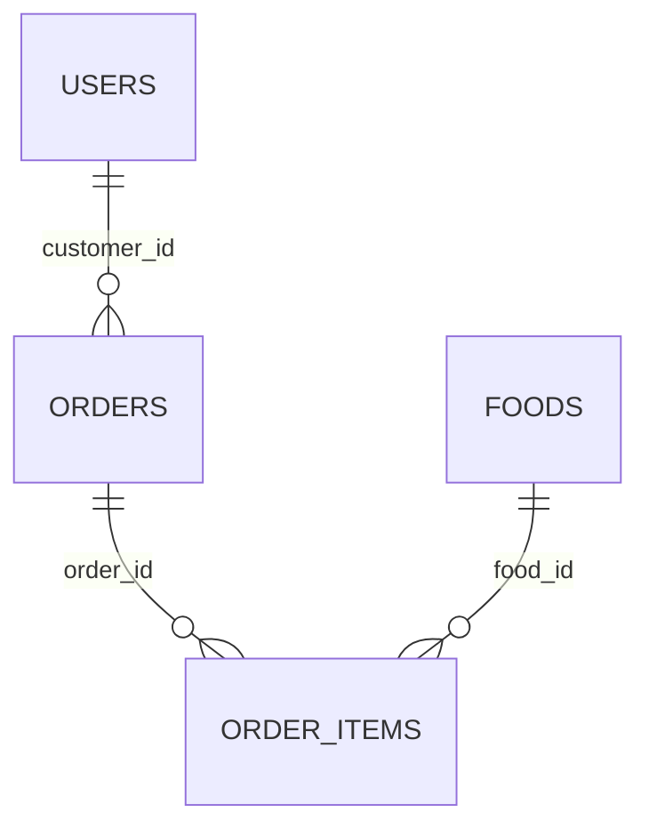

# Database design

PostgreSQL is accessed through Prisma ORM 7.10.0 and `@prisma/adapter-pg`. The database schema is in `prisma/schema.prisma`; checks not represented in Prisma's schema syntax are in SQL migrations.

An order must have at least one item when created through the API. The relational foreign key itself allows zero items so the schema diagram represents the database cardinality.

| Entity | Important columns | Keys, indexes, and checks |
| --- | --- | --- |
| `User` (`users`) | `id`, `name`, `email`, `password_hash`, `role`, `active`, timestamps | `id` primary key; `email` unique; index `(role, active)`; role enum `ADMIN`, `OPERATOR`, `CUSTOMER` |
| `Food` (`foods`) | `id`, `name`, `description`, `category`, `price DECIMAL(10,2)`, `available`, `archived`, timestamps | `id` primary key; indexes `(available, archived)` and `category`; price check requires positive and excludes PostgreSQL numeric NaN |
| `Order` (`orders`) | `id`, `reference`, `customer_id`, `status`, `notes`, `total DECIMAL(12,2)`, timestamps | `id` primary key; `reference` unique; FK `customer_id → users.id` (`RESTRICT` delete); indexes `(customer_id, created_at)` and `(status, created_at)`; total check is nonnegative and excludes NaN; status enum `PLACED`, `PREPARING`, `COMPLETED`, `CANCELLED` |
| `OrderItem` (`order_items`) | `id`, `order_id`, `food_id`, `food_name_snapshot`, `unit_price_snapshot DECIMAL(10,2)`, `quantity`, `line_total DECIMAL(12,2)` | `id` primary key; FKs `order_id → orders.id` (`CASCADE` delete), `food_id → foods.id` (`RESTRICT` delete); indexes on `order_id` and `food_id`; quantity positive; unit price nonnegative; line total nonnegative, NaN-excluded, and equal to snapshot price × quantity |

## Relationships and historical values

- A user may own many orders; each order has one customer.
- An order may contain many items; each item belongs to one order.
- A food may appear in many order items; each item references one food.
- `food_name_snapshot` and `unit_price_snapshot` preserve the catalog values when an order is placed. Editing a food later does not change the historical item, line total, or order total.
- Order totals are calculated with Prisma Decimal from current stored food prices and positive integer quantities. Money is not calculated with JavaScript floating point.

## Migrations and seed

1. `20261004190000_initial_database` creates the four tables, enums, foreign keys, indexes, and initial monetary/quantity checks.
2. `20261004193000_reject_nan_monetary_values` tightens the food price, order total, order-item unit-price, and line-total checks to explicitly reject PostgreSQL numeric `NaN`.

Do not edit applied migrations; add a forward migration only for an approved schema change. Run `npm run db:migrate` for local development or `npm run db:deploy` to apply committed migrations. `npm run db:seed` repeatably upserts four local users, four foods (one unavailable), and three sample orders with items and snapshots. Seed credentials are documented in the README and are local-only.
